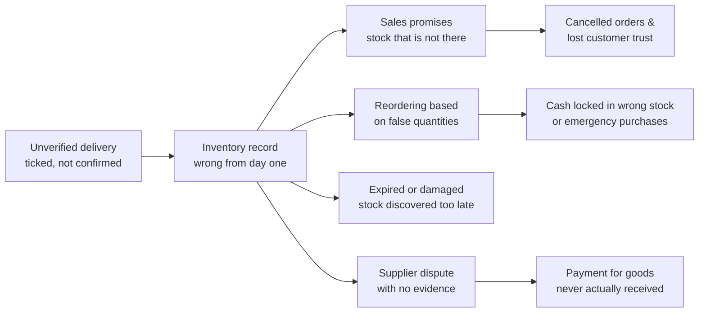
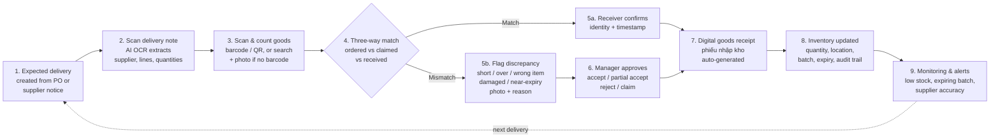

# VELO Vietnam — Receive. Verify. Record.

**Competition:** LIKELION — AI for Business Innovation  
**Product direction:** Warehouse receiving verification and inventory documentation for Vietnamese businesses  
**Status:** Product story and MVP definition for slide/demo development  
**Important evidence note:** Statements about current warehouse behaviour come from the team's problem observation. They must be validated with interviews and workplace evidence before being presented as market facts. All quantities in the impact model are formulas or clearly-labelled pilot targets — not claimed results.

---

## 1. Executive story

### The one-sentence pitch

**VELO turns warehouse receiving from a paper checklist into a verified digital control point: every delivery is checked against what was ordered, every discrepancy is evidenced, and inventory is updated only after a human confirms what physically arrived.**

### Tagline

> **Receive. Verify. Record.**  
> Every delivery verified. Every item accounted for.

### Why this exists

A warehouse can only sell, promise, produce, or deliver what it actually has. Yet for many businesses, inventory truth is created at the receiving door — the exact moment where the process is weakest.

When a supplier's truck arrives, an employee may receive a paper delivery note, look over the goods, tick a checklist, and sign. But ticking is not verification. The employee may not have the purchase order beside them. They may not count every carton, compare product codes, inspect damaged packaging, or check batch and expiry dates. The result is then copied — later, partially, or sometimes not at all — into Excel or an accounting system.

From that moment, the business is operating on assumed inventory.

VELO exists to fix that first moment. If receiving is verified and documented, every later decision becomes more reliable: sales can promise stock, managers can reorder correctly, finance can pay suppliers accurately, and warehouse teams can find goods without searching through memory and paper.

**Our belief:** technology should not replace the warehouse employee. It should give that employee a clear, fast way to prove what arrived, flag what is wrong, and stop errors before they enter the system.

---

## 2. Why we are doing it — the problem story

### 2.1 What happens today

A typical manual receiving process looks like this:

1. A supplier or driver arrives with goods and a paper delivery note (*phiếu giao hàng*).
2. The warehouse employee checks the delivery under time pressure while the driver waits.
3. The employee compares the goods visually against the note — often without the original purchase order (PO) open beside them.
4. Cartons are ticked off on paper. Partial deliveries, substituted products, damaged items, or near-expiry batches may be noted informally, in handwriting, in a chat message, or not at all.
5. The signed paper is filed. Someone later re-enters the result into Excel, accounting software, or an internal sheet — if the paper survives and the handwriting is readable.
6. Inventory now says the goods are in stock, whether or not they physically are.

### 2.2 Why a tick is not confirmation

The current checklist proves that a form was completed. It does not prove:

- that the quantity physically counted equals the quantity claimed;
- that the delivered product matches the ordered SKU, unit, pack size, or specification;
- that the goods were undamaged and acceptable;
- which batch arrived or when it expires;
- who counted it, when, and under what exception;
- whether the supplier later disputed the claim — and what evidence exists.

This is the central problem VELO addresses:

> **Receiving is treated as paperwork, not as the control point where inventory truth is created.**

### 2.3 The pain, by person

| Person | Daily pain | Consequence |
|---|---|---|
| **Warehouse receiver** | Must count, inspect, unload, answer the driver, and complete paperwork at the same time, with no guided comparison against the order | Exhausting, rigid work; errors are easy and blame is personal when stock later goes missing |
| **Warehouse manager** | Learns about shortages or damage hours later, from paper or chat, with no structured evidence | Cannot resolve supplier claims confidently; cannot trust stock reports |
| **Sales / customer-service staff** | Sell from inventory figures that were keyed in late or assumed | Overselling, cancelled orders, apologising to customers |
| **Finance / business owner** | Pays invoices against delivery paperwork that was never truly verified | Pays for goods never received, damaged, or substituted |
| **Supplier / driver** | Disputes are argued from memory and handwriting | Slow resolution, damaged business relationships |

### 2.4 The ripple effect

One unverified delivery creates downstream cost everywhere:



### 2.5 Root cause

The problem is not careless employees. It is a process design failure:

- The **order**, the **delivery note**, and the **physical goods** are three separate sources that are never systematically compared.
- Verification depends on memory, eyesight, and handwriting under time pressure.
- Documentation happens *after* the event, by re-typing, instead of *during* the event, as a by-product of checking.
- There is no structured record of exceptions — the exact cases that cost money.

VELO's job is to compare those three sources at the dock, guide the human through the comparison, and make documentation the automatic output of verification.

---

## 3. Target business and users

### 3.1 Beachhead segment

**Vietnamese building-materials and industrial-supplies distributors and retailers** operating one to five warehouses or large stores, handling hundreds to thousands of SKUs, receiving supplier deliveries daily or near-daily, and currently coordinating stock with paper, Excel, phone calls, and chat.

Why this segment first:

- Goods are bulky, heavy, and frequently damaged in transit — inspection matters.
- Cement, sealants, adhesives, paints, and chemicals carry batch and expiry risk.
- Deliveries are mixed: many SKUs per truck, partial deliveries, and substitutions are common.
- Supplier disputes over quantity and condition are expensive and recurring.
- Existing design assets for VELO (barcodes, batches, FEFO expiry) transfer directly.

Expansion path after the beachhead: general SME distribution warehouses (FMCG, electrical goods, spare parts) with the same receiving pain.

### 3.2 Primary users

| User | Role in VELO |
|---|---|
| **Receiver / warehouse employee** | Runs the receiving session on a phone: scans, counts, photographs, confirms |
| **Warehouse manager** | Reviews exceptions, approves discrepancies, monitors stock and supplier accuracy |
| **Owner / finance (secondary)** | Uses documented receipts to approve supplier payment |
| **Driver / supplier (participant, not user)** | Confirms discrepancies on the receiver's device at the dock |

---

## 4. How VELO solves it

### 4.1 The core mechanism: three-way match

VELO compares three sources for every delivery line:

1. **Ordered** — the purchase order or expected-delivery record;
2. **Claimed** — the supplier's delivery note;
3. **Received** — what the employee physically scans and counts.

A line is only "in stock" when all three agree, or when a named human approves the difference. This is established warehouse control practice; VELO makes it executable in minutes on a phone instead of impractical on paper.

### 4.2 The workflow



### 4.3 Step by step

**Step 1 — Expected delivery.** The manager creates or imports an expected delivery from a purchase order (manually, by Excel/CSV import, or by photographing the order). If a delivery arrives with no PO — common in practice — the receiver can start a "no-PO receipt"; the system simply matches claimed vs received and flags that no order reference exists.

**Step 2 — Scan the delivery note.** The receiver photographs or scans the supplier's delivery note. AI OCR extracts the supplier, document number, product lines, and quantities in Vietnamese or English. The receiver confirms the extraction before proceeding; OCR never silently writes data.

**Step 3 — Scan and count the goods.** For each line, the receiver scans the product barcode (EAN) or an internal QR label and enters/verifies the counted quantity. Three Vietnam-specific fallbacks are built in:

- product search by name/code when no barcode is scannable;
- photo capture of the product and its label as identification evidence;
- **printable internal QR labels** generated at receiving, so goods without usable supplier barcodes become trackable from that moment.

Condition is recorded per line: good, damaged (photo required), or near-expiry (batch/expiry captured).

**Step 4 — Live three-way match.** As counting proceeds, each line shows a live status:

| Status | Meaning |
|---|---|
| 🟢 Match | Ordered = claimed = received, condition good |
| 🟡 Partial / attention | Short or over quantity, near-expiry batch, no-PO line |
| 🔴 Mismatch | Wrong product, damaged goods, large variance |

The receiver no longer compares documents in their head; the system does the arithmetic and the human judges the exceptions.

**Step 5 — Confirm or flag.** Matching lines are confirmed with the receiver's identity and a timestamp. Mismatches require a structured reason (short delivery, over delivery, wrong item, damaged, expired/near-expiry, substituted) and, for damage, a photo. The driver can confirm the discrepancy on the device at the dock, while both parties are still present.

**Step 6 — Manager approval.** Discrepancies go to the manager's dashboard as an approval queue: accept as-is, partially accept, reject the line, or open a supplier claim. Nothing exceptional enters inventory without a named approver.

**Step 7 — Digital goods receipt.** On completion, VELO generates the goods receipt note (*phiếu nhập kho*) automatically — supplier, lines, accepted quantities, exceptions, receiver, approver, timestamps, and evidence links. Documentation is now the output of the work, not extra work after it.

**Step 8 — Inventory and monitoring.** Accepted goods update live inventory with storage location, batch, and expiry. Every movement is in an audit trail: who received it, what was claimed, what was accepted, and what changed. The dashboard then monitors low stock, batches approaching expiry (FEFO — first-expired, first-out), unresolved claims, and each supplier's delivery accuracy over time.

### 4.4 What the AI does — and what it does not do

Judges will ask "where is the AI, really?" This separation is the honest answer.

| Layer | Responsibility | Why |
|---|---|---|
| **AI** | OCR extraction from Vietnamese/English delivery notes and labels; fuzzy matching of supplier product names/descriptions to internal SKUs (e.g. "Keo Sika 11FC 600ml" → `SKF-11FC-600`); anomaly hints (quantity far outside this supplier's or product's usual pattern); later: receiving-volume and stock-out forecasting | These are perception and pattern tasks where AI genuinely outperforms rules |
| **Deterministic rules** | Three-way match arithmetic, variance thresholds, expiry windows, approval routing, receipt generation | Control logic must be predictable and auditable — rules are a feature, not a weakness |
| **Human** | Counts, inspects, photographs, confirms, approves exceptions | VELO recommends and records; people decide. No silent inventory changes |

### 4.5 Design principles

1. **Verification before documentation.** Stock is created by a confirmed count, never by copying a delivery note.
2. **Exceptions are first-class.** The money is in the mismatches; they get structure, photos, owners, and deadlines — not handwriting.
3. **Works with the warehouse as it is.** Existing barcodes where present; search, photo, and printable QR where not. Phones employees already carry; no scanner hardware to buy.
4. **Offline-tolerant.** Receiving happens in yards and metal sheds; sessions must keep working without connectivity and sync when it returns. *(MVP: stated design requirement; to be demonstrated or honestly scoped in the demo.)*
5. **Every number has a name on it.** Receiver, approver, timestamp, evidence. Accountability without blame culture: the record protects the honest employee.

---

## 5. MVP scope

The MVP proves one claim end-to-end: **a delivery can be received, verified, documented, and reflected in live inventory through VELO, with discrepancies caught and evidenced.**

### 5.1 In scope

| # | Capability | MVP behaviour |
|---|---|---|
| 1 | Expected delivery | Create manually or import via CSV; no-PO receiving mode supported |
| 2 | Delivery-note capture | Photo/scan of note; OCR-extracted lines shown for receiver confirmation (demo may use a seeded note image) |
| 3 | Item verification | Camera barcode scan (EAN) with manual code entry fallback; product search; counted quantity per line; batch/expiry capture where relevant |
| 4 | Condition & evidence | Good/damaged status; photo required for damage; structured discrepancy reasons |
| 5 | Three-way match | Live per-line status (match / partial / mismatch) computed as counting proceeds |
| 6 | Confirmation & approval | Receiver confirms with identity + timestamp; discrepancy queue for manager: accept / partial / reject / claim |
| 7 | Digital receipt | Auto-generated *phiếu nhập kho* (viewable/exportable summary) for each completed session |
| 8 | Inventory & audit | Stock quantities updated on acceptance; location field; full session audit trail (who/what/when/evidence) |
| 9 | Monitoring dashboard | Current stock, low-stock list, batches expiring within a configurable window, open discrepancies, supplier accuracy per delivery |
| 10 | Demo data mode | Seeded catalogue, one supplier, one expected delivery with a planted discrepancy (see §7) so the full story runs in under two minutes |

### 5.2 Explicitly out of scope (roadmap, one line each on slides)

- Put-away optimisation and warehouse route guidance;
- Sales/POS integration and automatic customer-order allocation;
- Demand forecasting and automatic purchase-order generation;
- Multi-warehouse transfers and network stock balancing;
- Full ERP/accounting integration (MVP stops at CSV import/export);
- Automated supplier-payment approval by finance.

### 5.3 MVP platform shape

- **Receiver app:** mobile web app on ordinary smartphones (camera barcode scanning, e.g. ZXing); no native install, no dedicated hardware.
- **Manager dashboard:** web page showing receiving sessions, approval queue, inventory, and alerts.
- **Backend:** one small service + one database holding catalogue, expected deliveries, receiving sessions, inventory, and audit events. Chosen for build speed and demo reliability, not architectural theatre.
- **AI services:** OCR + name-matching called at note-capture time, with human confirmation of every extracted field.

### 5.4 Demo scenario (the two-minute story)

> Expected: 100 tubes of SikaFlex sealant from Supplier A, plus 20 bags of cement.
>
> 1. The receiver scans the delivery note; VELO lists the claimed lines.
> 2. Counting finds **96 tubes in good condition, 4 tubes crushed**, and a sealant batch expiring in 20 days. Cement matches.
> 3. VELO flags: 🔴 4 damaged (photo taken, driver confirms on screen), 🟡 near-expiry batch (FEFO alert created).
> 4. The manager approves "accept 96, claim 4" from the dashboard.
> 5. The digital *phiếu nhập kho* is generated; inventory shows 96 tubes with batch and expiry, the damaged 4 exist only as a documented claim, and Supplier A's accuracy record drops accordingly.
>
> **Closing line:** "Ninety-six tubes entered stock. Four entered a claim. Zero entered by assumption."

---

## 6. Expected impact

Impact is expressed as mechanisms, measurable pilot indicators, and formulas. The team must replace illustrative values with measured baselines during validation (§8) before quoting results.

### 6.1 Impact mechanisms

| Mechanism | How VELO creates it | Who benefits |
|---|---|---|
| Errors stopped at the door | Short/over/wrong/damaged goods are caught during receiving, not discovered weeks later | Owner, warehouse manager |
| Documentation without extra work | The receipt, audit trail, and stock update are by-products of the checking flow | Receiver, finance |
| Evidence for every exception | Photo + reason + driver confirmation + approver, timestamped | Manager, supplier relationship |
| Inventory that can be trusted | Stock only changes on confirmed acceptance | Sales, customers, planning |
| Supplier performance visibility | Accuracy is recorded per delivery and aggregated per supplier | Purchasing, owner |
| Expiry and damage control | Batch/expiry captured at entry; FEFO alerts before value is lost | Warehouse, finance |
| Less exhausting receiving | The system holds the comparison; the employee counts, judges exceptions, and confirms | Receiver |

### 6.2 Pilot success indicators (targets to validate, not results)

Measure these in a pilot against the business's current baseline:

| Indicator | Definition | Illustrative pilot target* |
|---|---|---|
| Receiving documentation completeness | % of deliveries with a complete digital record (lines, receiver, timestamp, exceptions) | ≥ 95% of deliveries |
| Discrepancy capture rate | Discrepancies recorded in VELO ÷ discrepancies found by later spot-audit | ≥ 90% captured at receiving |
| Time to produce stock figure | Minutes from delivery completion to trusted, visible stock | Same session (vs hours–days) |
| Receiving effort | Person-minutes per delivery, VELO vs paper baseline | No slower than paper; target 20–30% faster after week 2 |
| Inventory record accuracy | Cycle-count agreement on VELO-managed SKUs | ≥ 98% on sampled SKUs |
| Supplier claim resolution time | Days from discrepancy to agreed resolution | Measurable reduction vs baseline |
| Expiry write-off | Value of stock expired before sale on monitored categories | Reduction trend over pilot |

\*Targets are hypotheses for a 4–8 week single-warehouse pilot. They are goals to test, not evidence. Slides must label them as such.

### 6.3 Business-value model (fill in with real baseline)

Monthly value for one warehouse:

```
Value = (deliveries/month × minutes saved per delivery × loaded labour cost/min)
      + value of discrepancies caught before supplier payment
      + value of expiry/damage losses avoided
      + margin protected from cancelled oversold orders
      − VELO subscription
```

Pricing story for feasibility slides: **per-warehouse subscription**, employees' existing phones, no scanner hardware purchase, CSV import/export to coexist with current Excel/accounting habits. State a price only after checking what comparable Vietnamese SME software charges and what interviewees say they would pay.

---

## 7. Weaknesses, judge objections, and the proof we need

This section is the defence plan. Each weakness names the objection honestly, the mitigation in the product, and the evidence required to make the claim credible.

### 7.1 Evidence gaps — proof we must collect

| # | Claim we want to make | Current status | Proof required | How to get it (fast) |
|---|---|---|---|---|
| E1 | "Receiving is manual, tick-based, and unverified" | Team observation; not yet market evidence | Interviews + artefacts | Interview 3–5 warehouse staff/managers at building-materials businesses (HCMC); photograph anonymised paper checklists, delivery notes, Excel stock files (with permission) |
| E2 | "Errors and disputes actually cost money" | Assumed | Concrete incidents with magnitudes | Ask each interviewee: last discrepancy, what happened, what it cost, how long resolution took. Quote two incidents (anonymised) on the problem slide |
| E3 | "Employees find receiving exhausting/rigid" | Team observation | Direct user voice | Short quotes from receivers; if possible, observe/photograph one real receiving session |
| E4 | "Businesses will pay for this" | Unproven | Willingness-to-pay signal | Ask interviewees what they pay for current software and what verified receiving is worth; one letter/message of pilot interest beats any survey |
| E5 | "VELO is faster / more accurate" | Unproven | Timed comparison | Time a volunteer doing one mock delivery on paper vs in the MVP; report honestly, even if MVP is only equal on speed — accuracy/evidence is the primary claim |
| E6 | "OCR works on real Vietnamese delivery notes" | Unproven | Test on real samples | Run OCR on 5–10 collected (anonymised) delivery notes; report field-level accuracy and the human-confirmation step that covers failures |

**Rule for slides:** any claim without E-level proof behind it is labelled an assumption or a pilot target. Judges reward this discipline under Feasibility.

### 7.2 Product weaknesses and mitigations

| Weakness | Why it is real | Mitigation in product | Residual risk to admit |
|---|---|---|---|
| Many goods lack scannable barcodes | SME suppliers use handwritten labels, repacked cartons, bulk materials | Search + photo identification; printable internal QR labels applied at receiving; manual count mode | First receipt of an unlabelled product is slower; labelling discipline must be built over time |
| Suppliers' notes are inconsistent | Formats, units, and product names vary by supplier; handwriting is common | OCR with mandatory human confirmation; fuzzy name-to-SKU matching that learns confirmed pairs; no-PO mode | OCR accuracy on poor handwriting is limited; VELO must never pretend otherwise — confirmation step is the safeguard |
| Counting bulk goods is genuinely hard | Cement bags, timber, steel are counted/weighed, not scanned piece-by-piece | Count by unit/pallet with photo of the stack; variance tolerance per product type; manager approval for bulk variances | VELO verifies declared counts; it cannot weigh a truck. Say so |
| Employees may resist "being monitored" | Audit trails can feel like surveillance | Position as protection: the record proves the receiver did their job; discrepancies are supplier facts, not personal blame; involve receivers in pilot feedback | Adoption still needs manager behaviour change; include a short training/onboarding step in rollout |
| Garbage catalogue, garbage system | If SKU data and units are messy, matching fails | MVP includes catalogue clean-up import (CSV) and unit/pack definitions; start pilot with top SKUs by delivery volume | Data clean-up is real work; scope the pilot SKU set honestly |
| Connectivity at the dock | Yards and metal warehouses have poor signal | Offline-tolerant session design; sync on reconnect *(design requirement — demonstrate or scope honestly)* | If not implemented for the demo, present as roadmap, not as a feature |
| Integration expectations | Businesses run Excel, accounting software, sometimes ERP | CSV import/export in MVP; API integration as paid later phase | Manual export is a compromise; name it |

### 7.3 Judge objections — prepared answers

**"Isn't this just a digital checklist / inventory app?"**  
A checklist records ticks. VELO enforces a three-way match between order, supplier claim, and physical count; blocks silent stock creation; structures exceptions with evidence and approval; and only then updates inventory. The checklist is the interface; the control system is the product.

**"Where is the AI? Matching quantities is just rules."**  
Correct — and deliberately so. Control arithmetic should be deterministic and auditable. AI does the perception work rules cannot: reading Vietnamese delivery documents, resolving supplier naming chaos into SKUs, and (next) flagging anomalous patterns and forecasting. We will show OCR on a real note in the demo rather than claim magic.

**"Existing WMS/ERP software already does receiving."**  
For large enterprises, yes — at enterprise cost, hardware, and implementation time. Our segment runs paper and Excel because those systems are too heavy and too expensive to adopt at the receiving door. VELO is phone-first, deploys in days, exports to the tools they already use, and can later feed an ERP instead of competing with it.

**"What if employees just fake the counts?"**  
No system fully prevents collusion, and we won't claim otherwise. VELO raises the cost of error and fraud: identity-stamped confirmations, photo evidence for damage, driver co-confirmation at the dock, manager approval for exceptions, and an audit trail that makes patterns visible. That is a control improvement, not a surveillance promise.

**"Suppliers won't cooperate."**  
Suppliers are not asked to change anything: they keep their delivery notes. The driver only confirms a discrepancy that is already physically in front of both parties — which protects honest suppliers too, because VELO also documents correct deliveries.

**"Why building materials? Is the market big enough?"**  
It is the beachhead, chosen because damage, batch/expiry, and mixed-SKU deliveries make verification most valuable there — and because our team's domain work (barcodes, FEFO) already fits. The receiving problem is identical across SME distribution; expansion is a segment change, not a product rebuild. *(Support with interview evidence, E1/E4.)*

**"Your impact numbers — where are they from?"**  
They are labelled pilot targets with the measurement method defined (§6.2). Our validated facts are the interview findings and artefact evidence; our commitment is a 4–8 week single-warehouse pilot with agreed success gates. Do not present targets as results.

### 7.4 Risks and responsible-AI notes (brief's explicit requirement)

- **Data sensitivity:** inventory and supplier pricing are commercially sensitive; access is role-based (receiver / manager), and submission materials must contain no real business data — anonymise all collected evidence.
- **AI reliability:** OCR/matching output is always human-confirmed before it affects stock; confidence is shown, errors are correctable, and corrections improve matching.
- **Accountability:** the system recommends and records; named humans confirm counts and approve exceptions. No automatic supplier payment or stock write-off.
- **Failure mode:** if scanning/OCR fails, the receiver can always complete a manual count; VELO degrades to a structured digital form, never blocks the delivery.

---

## 8. Validation and pilot plan

### 8.1 Before submission (this week)

1. Conduct 3–5 short interviews (warehouse receiver, warehouse manager, owner) at building-materials/industrial-supplies businesses; capture process, pain incidents, and costs (E1–E4).
2. Collect anonymised artefacts: paper checklist, delivery note, goods receipt, Excel stock sheet (E1, E6).
3. Test OCR on the collected notes; record accuracy honestly (E6).
4. Lock the demo scenario (§5.4) and seeded data; rehearse the paper-vs-VELO timed comparison if a volunteer is available (E5).

### 8.2 Pilot proposal (for the Feasibility slide)

| Phase | Duration | Content | Exit gate |
|---|---|---|---|
| Prepare | Week 1–2 | Catalogue clean-up (top SKUs), expected-delivery import, receiver training | Catalogue and units agreed with warehouse manager |
| Shadow run | Week 3–4 | VELO runs alongside paper; compare records daily | Documentation completeness ≥ 95%; no delivery blocked by VELO |
| Live run | Week 5–8 | VELO is the system of record for receiving; weekly review of discrepancies and supplier claims | Indicators in §6.2 measured against baseline; manager confirms trust in stock figures |
| Decide | End of week 8 | Review value model with real numbers; expand SKUs/warehouses or stop | Owner signs off expansion or documents why not |

---

## 9. Future beyond receiving (roadmap in one paragraph)

Receiving is where inventory truth is created; once VELO owns that moment, the same verified stock enables put-away guidance, FEFO shelf rotation, low-stock and reorder recommendations, demand forecasting, and eventually multi-warehouse balancing. The expansion order is deliberate: **verify inbound → trust inventory → optimise movement → predict demand.** Each stage is only credible because the previous one made the data real.

---

## 10. Slide mapping (competition structure, max 15 slides, English)

| Slide | Content from this document |
|---|---|
| 1. Title | VELO — Receive. Verify. Record. Team, tagline |
| 2. Business Problem | §2.1–2.2: the tick that is not confirmation |
| 3. Target Business & Users | §3: beachhead segment, user table |
| 4. Business Insight | §2.3–2.5: ripple effect, root cause (interview evidence here) |
| 5. Proposed Solution | §4.1–4.2: three-way match + workflow diagram |
| 6. How AI Helps | §4.4: AI vs rules vs human |
| 7. How It Works | §4.3: step-by-step with phone/dashboard visuals |
| 8. Mockup / Demo | §5.4: the 96/4 discrepancy scenario |
| 9. Feasibility & Business Value | §5.3, §6.3, §8.2: platform, value formula, pilot plan |
| 10. Competitive Advantage | Phone-first, no hardware, works without barcodes (QR labels), evidence-by-design; vs paper, vs enterprise WMS, vs generic checklist apps |
| Appendix (optional) | §7.2–7.4: weaknesses, responsible AI, risks |

---

## 11. Source and claim discipline

- **Competition requirements** (theme, slide structure, deadlines, scoring): LIKELION "AI for Business Innovation" brief (Notion), extracted 2026-11-11.
- **Problem description:** team observation of Vietnamese warehouse receiving practice as stated by the team; **to be validated** per §7.1 before being presented as fact.
- **Product behaviour:** this document defines intended MVP behaviour. The current repository contains a landing page and a scripted, hard-coded demo player (`public/demo/`, data explicitly illustrative); the receiving MVP in §5 is **to be built** and must not be described as already working until it is.
- **Numbers:** all impact figures herein are formulas or labelled pilot targets. No market statistics are asserted; any external statistic added later must carry a named source and date.
